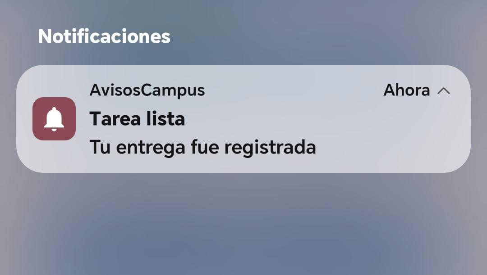
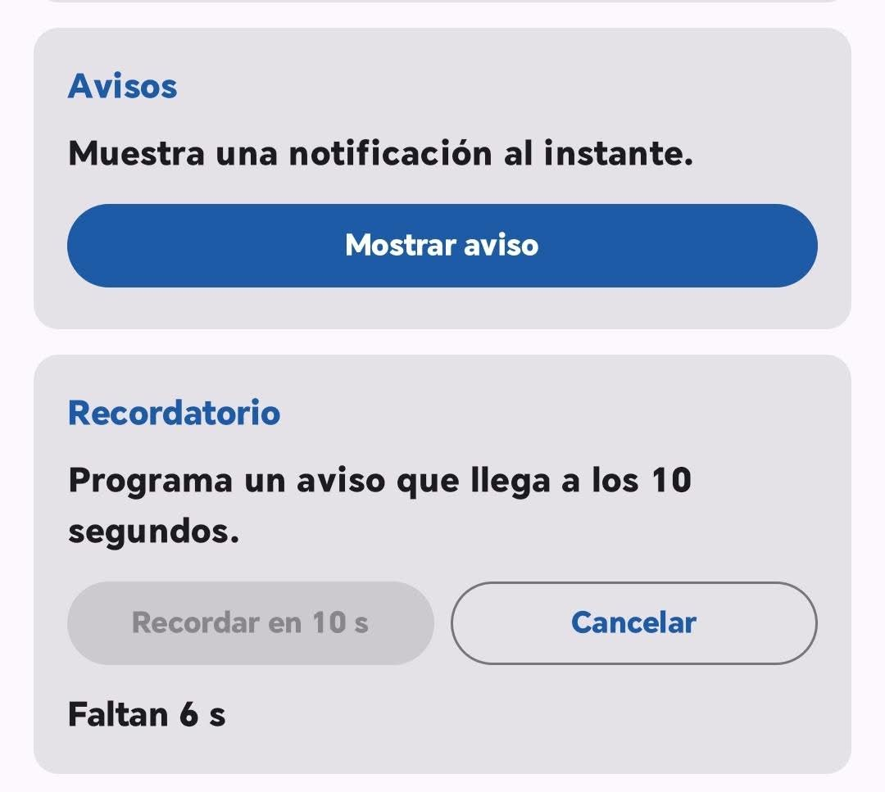
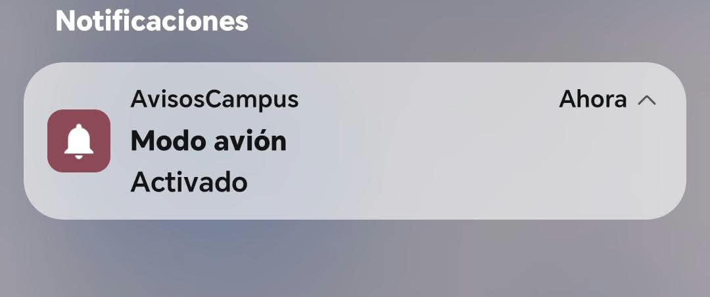
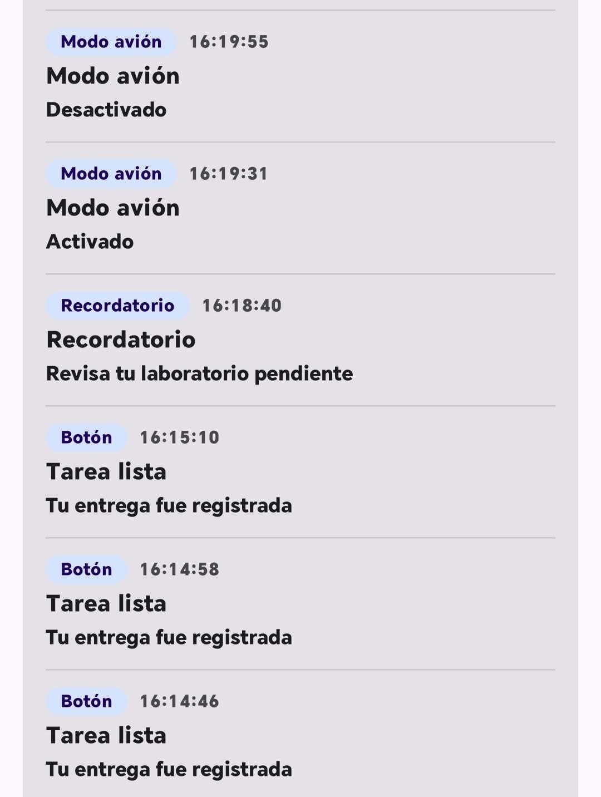
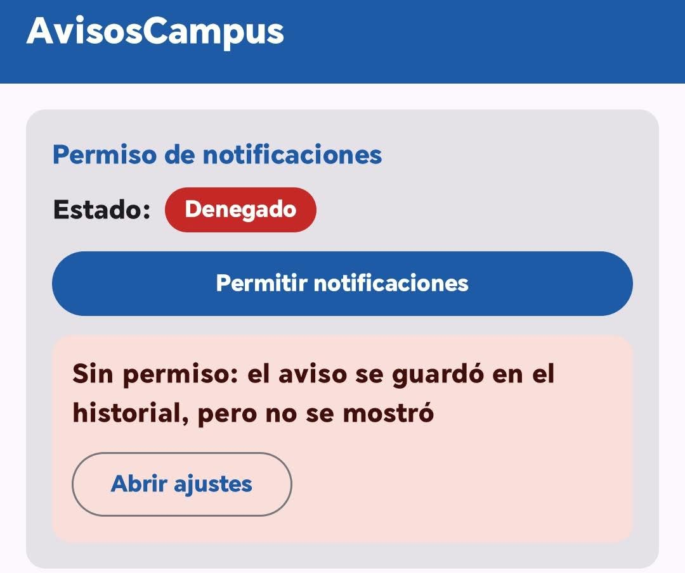

# AvisosCampus

**Laboratorio 15 – Notificaciones en Android** · Programación en Móviles · Tecsup
Autora: Kiara Alburqueque ([@kiaraalburqueque-stack](https://github.com/kiaraalburqueque-stack))

AvisosCampus es una app Android (Kotlin + Jetpack Compose + Material 3) que muestra notificaciones
locales y escucha lo que pasa en el celular. Con un botón muestra un aviso, con otro programa un
recordatorio que llega a los 10 segundos, y con un switch avisa cuando se activa o desactiva el modo
avión. Todo queda anotado en un historial. Usa solo datos ficticios.

## Funcionalidades

| Función | Cómo se hizo |
|---|---|
| Canal «Avisos» | `NotificationChannel` creado una vez en `AvisosApp.onCreate` (Android 8+) |
| Permiso | `POST_NOTIFICATIONS` pedido con `RequestPermission` (Android 13+); etiqueta Sin pedir / Permitido / Denegado |
| Mostrar aviso | `NotificationCompat.Builder` + `NotificationManagerCompat.notify(aviso.id, …)` |
| Abrir la app | `PendingIntent.getActivity(…, FLAG_IMMUTABLE)` + `setAutoCancel(true)` |
| Recordatorio | Corrutina en `viewModelScope` con `delay(1000)`, cuenta regresiva y cancelación |
| Modo avión | `ModoAvionReceiver` registrado con `DisposableEffect` y quitado en `onDispose` |
| Historial | Los 20 avisos más recientes, con origen, título, texto y hora |
| Permiso denegado | Mensaje de error + botón **Abrir ajustes**; la app nunca se cierra |

## Estructura de paquetes

```
com.alburqueque.avisocampus/
├── AvisosApp.kt                 Application: crea el canal al iniciar
├── MainActivity.kt              crea el ViewModel y muestra PantallaAvisos
├── model/
│   └── Modelos.kt               Aviso, Origen, PermisoUi
├── data/
│   └── AvisosRepository.kt      interface + AvisosRepositoryMemoria (historial)
├── notificacion/
│   └── Notificador.kt           crearCanal, tienePermiso y mostrar
├── receiver/
│   └── ModoAvionReceiver.kt     BroadcastReceiver del modo avión
├── viewmodel/
│   ├── AvisosViewModel.kt       permiso, avisos, recordatorio, receptor y mensaje
│   └── AvisosViewModelFactory.kt
└── ui/
    ├── PantallaAvisos.kt        tarjetas, permiso, eventos y registro del receptor
    ├── HistorialAvisos.kt       tarjeta Historial (no conoce el ViewModel)
    └── theme/
```

## Arquitectura MVVM + Repository

```
View (PantallaAvisos)
  | eventos: botones, switch                 ^ collectAsState()
  v                                          |
ViewModel (AvisosViewModel) --- StateFlow (avisos, permiso, faltan, escuchandoAvion, mensaje) --->
  | registra el aviso          | emite: eventos (SharedFlow<Aviso>)
  v                            v
AvisosRepository (interface)   View recibe el evento y llama a
  -> AvisosRepositoryMemoria   Notificador.mostrar(context, aviso)
                                 -> false: vm.noSePudoMostrar()
```

| Capa | Conoce a | No hace |
|---|---|---|
| View (`ui/`) | Su ViewModel y el Notificador | Decidir qué se avisa ni guardar el historial |
| ViewModel | Solo la interface del Repository | Usar `Context`, `NotificationManager` ni `BroadcastReceiver` |
| Repository | Nada de la UI | Usar `Context` |
| Notificador | El sistema (canal, `NotificationManagerCompat`) | Guardar estado de la app |

## Capturas

| Notificación en el panel | Recordatorio | Modo avión | Historial | Permiso denegado |
|---|---|---|---|---|
|  |  |  |  |  |

## Pruebas de aceptación (Paso 9)

| Prueba | Resultado esperado | OK |
|---|---|---|
| Ajustes → Apps → AvisosCampus → Notificaciones | Existe el canal Avisos | ☐ |
| Pulsar Permitir notificaciones | Aparece el cuadro de Android y la etiqueta cambia | ☐ |
| Pulsar Mostrar aviso | Aparece la notificación Tarea lista | ☐ |
| Pulsar Mostrar aviso dos veces | Aparecen dos notificaciones distintas | ☐ |
| Tocar la notificación | Se abre la app y la notificación desaparece | ☐ |
| Recordar en 10 s | Cuenta regresiva y aviso al llegar a 0 | ☐ |
| Recordar y minimizar la app | El aviso llega igual | ☐ |
| Recordar y cancelar | No llega ningún aviso | ☐ |
| Switch activado y cambiar el modo avión | Aviso Activado y luego Desactivado | ☐ |
| Switch desactivado y cambiar el modo avión | No hay aviso | ☐ |
| Permiso denegado y Mostrar aviso | Mensaje de error, aviso en el historial y la app no se cierra | ☐ |
| Rotar la pantalla durante el recordatorio | La cuenta regresiva continúa | ☐ |
| Revisar el código | No hay `Context` en `viewmodel/` y todo receptor se quita en `onDispose` | ☐ |

## Para pensar

**1. ¿Por qué una notificación necesita un canal y un permiso? ¿Qué pasa si falta cada uno?**
Desde Android 8 cada notificación pertenece a un canal, y el usuario controla cada canal por separado
(sonido, importancia, apagarlo). Desde Android 13 la app además necesita el permiso
`POST_NOTIFICATIONS`, para que el usuario decida si la app puede avisarle. Si falta el canal, la
notificación no se muestra y Logcat registra un error. Si falta el permiso, el sistema la descarta en
silencio: por eso `mostrar()` lo comprueba primero y devuelve `false`.

**2. ¿Por qué el ViewModel emite un evento y no muestra la notificación él mismo?**
Mostrar una notificación necesita un `Context`, y el ViewModel vive más que la Activity (sobrevive a la
rotación). Si guardara un `Context`, filtraría memoria. Además, así el ViewModel solo decide qué avisar
y se puede probar sin Android. La pantalla, que sí tiene `Context`, recibe el evento y llama al
`Notificador`. Usamos un `SharedFlow` porque es un evento de una sola vez: no se debe repetir al rotar.

**3. ¿Qué pasa si usas el mismo id en dos notificaciones?**
La segunda reemplaza a la primera en el panel: solo se ve una. Por eso se usa `aviso.id`, que el
Repository incrementa en cada registro, y al pulsar Mostrar aviso dos veces aparecen dos notificaciones.
Reutilizar un id sirve a propósito para actualizar una notificación, por ejemplo una barra de progreso.

**4. ¿Por qué `onReceive` debe ser corto y por qué hay que quitar el receptor al salir?**
`onReceive` se ejecuta en el hilo principal: si tarda, la interfaz se congela y Android puede mostrar
"La app no responde". Por eso solo lee el dato y se lo pasa al ViewModel. Hay que quitar el receptor
porque el sistema guarda una referencia a él (y a la pantalla que lo creó): si no se quita en
`onDispose`, se filtra memoria y sigue recibiendo anuncios aunque la pantalla ya no exista.

**5. ¿En qué casos usarías una notificación local y en cuáles una push de Firebase?**
Local, cuando la propia app sabe qué y cuándo avisar sin internet: un recordatorio, una alarma, un
temporizador o un cambio del celular como el modo avión. Push de Firebase, cuando el aviso nace en un
servidor o en otra persona: un mensaje nuevo, una nota publicada por el docente o una oferta, que deben
llegar aunque la app esté cerrada.

## Cómo ejecutar

1. Abrir la carpeta en Android Studio y pulsar **Sync Now**.
2. Ejecutar en un celular o emulador con Android 13 o superior (API 33+) para ver el cuadro de permiso.
